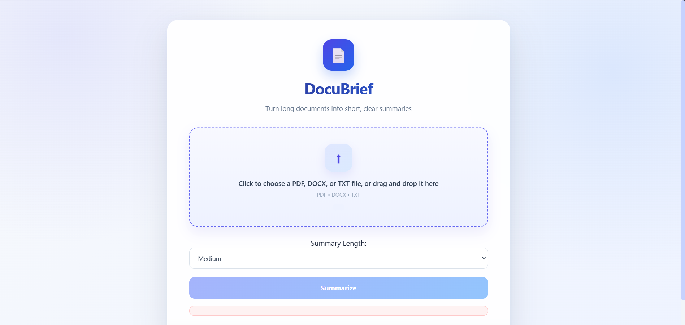
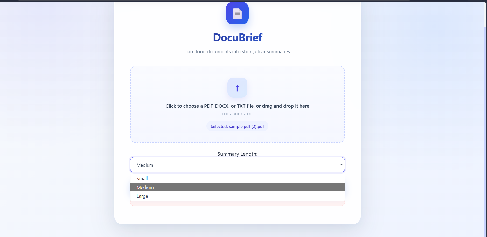
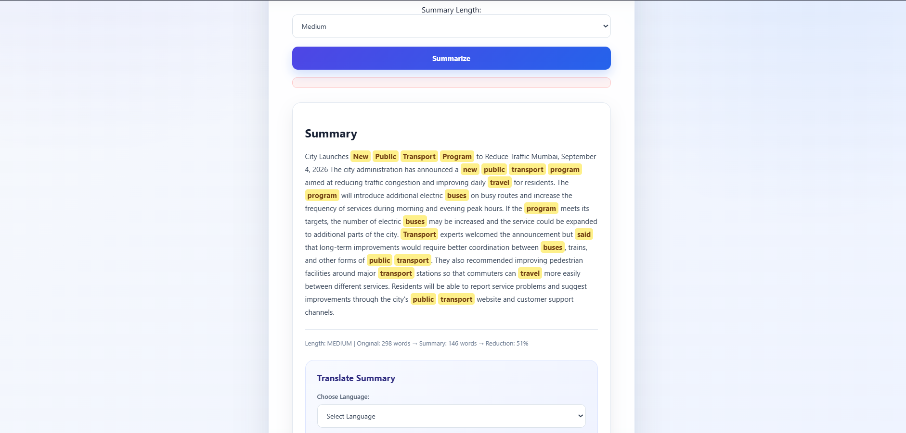
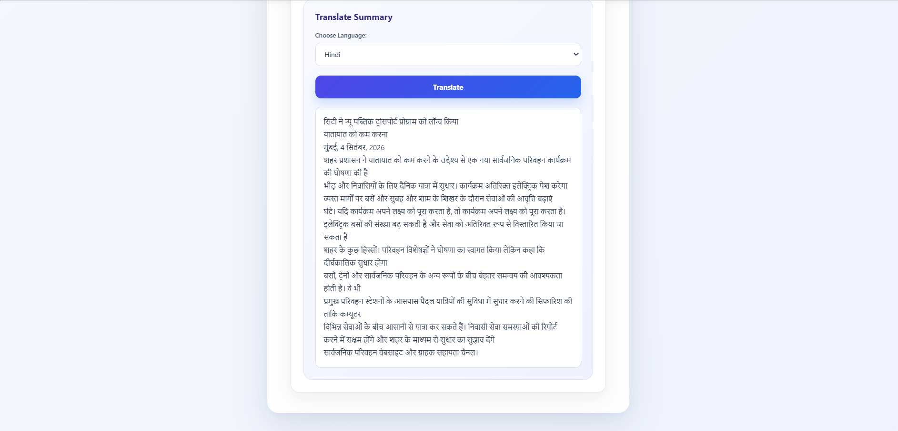

# 📄 DocuBrief – Document Summarization System

DocuBrief is an NLP mini-project that converts long documents into short,
easy-to-read summaries. Users upload a file, choose a summary length, and
get the key points in seconds.

## ✨ Features

- 📁 Supports **PDF, DOCX, and TXT** files
- 📝 **Extractive summarization** using TF-IDF sentence scoring
- 📏 Choose **Small, Medium, or Large** summaries (auto-adjusts to document size)
- 🔑 **Keyword extraction and highlighting**
- 🌐 **Translation** into English, Hindi, and Marathi
- 📊 Shows page count, word count, and reduction percentage
- 🖱️ Clean web interface with drag-and-drop upload

## 📸 Screenshots

### Home Page


### Choose Summary Length & Language


### Summary with Highlighted Keywords


### Translated Summary

## 🛠️ Tech Stack

| Purpose | Technology |
|---|---|
| Language | Python |
| Backend | Flask |
| PDF extraction | PyMuPDF |
| Word files | python-docx |
| NLP | NLTK, scikit-learn (TF-IDF) |
| Translation | deep-translator |
| Frontend | HTML, CSS, JavaScript |

## ⚙️ How It Works

```
Upload File → Text Extraction → Preprocessing → TF-IDF Sentence Scoring
→ Select Top Sentences → Highlight Keywords → (Optional) Translate → Display
```

## 🚀 How to Run

1. Clone the repository
```
   git clone https://github.com/sahilbhosale10/DocuBrief.git
   cd DocuBrief
```
2. Create and activate a virtual environment
```
   python -m venv venv
   venv\Scripts\activate          (Windows)
   source venv/bin/activate       (Mac/Linux)
```
3. Install dependencies
```
   pip install -r requirements.txt
```
4. Run the app
```
   python app.py
```
5. Open `http://127.0.0.1:5000` in your browser

## ⚠️ Limitations

- Works best on text-based documents; scanned/image PDFs are not supported (no OCR)
- Bullet-heavy or table-heavy documents may produce less coherent summaries
- Translation requires an internet connection

## 🔮 Future Scope

- OCR support for scanned documents
- Abstractive summarization using Transformer models (BERT/T5)
- Download summary as PDF/TXT
- Support for more languages

## 📚 Academic Context

Developed as an NLP mini-project for BTech IT.


